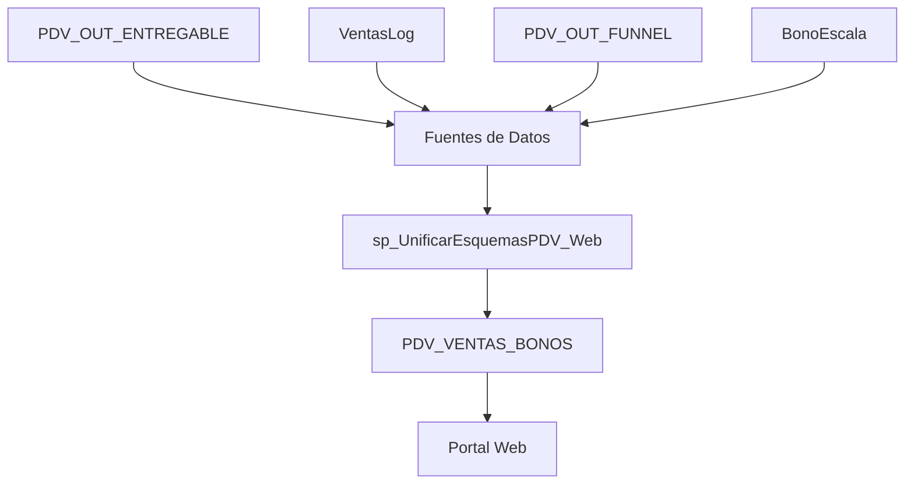

# PDV_VENTAS_BONOS - Documentación Técnica

## 📋 Resumen Ejecutivo

Este documento describe la implementación de una solución optimizada para el cálculo y almacenamiento de bonos de PDV (Puntos de Venta), reemplazando el enfoque individual del `spCalculoPayment_10` por un sistema consolidado basado en tablas pre-calculadas.

### 🎯 Objetivos Alcanzados

- **Performance**: Reducción drástica de tiempo de consulta para el portal web
- **Escalabilidad**: Manejo eficiente de grandes volúmenes de datos
- **Mantenibilidad**: Código modular y bien documentado
- **Consistencia**: Datos unificados y coherentes

---

## 🏗️ Arquitectura de la Solución

### Componentes Principales

1. **Tabla Consolidada**: `PDV_VENTAS_BONOS`
2. **Stored Procedure Unificado**: `sp_UnificarEsquemasPDV_Web`
3. **Índices Optimizados**: Para consultas ultra-rápidas

### Flujo de Datos



---

## 📊 Estructura de la Tabla PDV_VENTAS_BONOS

### Campos Principales

| Campo | Tipo | Descripción |
|-------|------|-------------|
| `DNI_RESPONSABLE` | INT | Identificador único del responsable |
| `NOMBRE_RESPONSABLE` | VARCHAR(255) | Nombre del responsable |
| `ZONAL` | VARCHAR(100) | Zona geográfica |
| `TIPO_PDV` | VARCHAR(50) | Tipo de PDV (PREMIUM/REGULAR) |
| `AÑO` | INT | Año del período |
| `MES` | INT | Mes del período |

### Campos de Ventas y Cantidades

| Campo | Tipo | Descripción |
|-------|------|-------------|
| `VENTA_AVANCE_PREPAGO` | INT | Ventas totales del mes (sin límite) |
| `cantidadRecarga` | INT | Cantidad de recargas |
| `cantidadCalidad` | INT | Cantidad de ventas de calidad |
| `cantidadPortaPre` | INT | Cantidad de portabilidades prepago |
| `cantidadAltaPost` | INT | Cantidad de altas postpago |
| `cantidadPortaPostOPost` | INT | Portabilidades postpago origen postpago |
| `cantidadPortaPostOPre` | INT | Portabilidades postpago origen prepago |

### Campos de Cálculo y Límites

| Campo | Tipo | Descripción |
|-------|------|-------------|
| `ratio` | DECIMAL(10,2) | Ratio de recargas (%) |
| `ratioCalidad` | DECIMAL(10,2) | Ratio de calidad (%) |
| `maxVenta` | INT | Límite máximo desde BonoEscala |
| `VentaPrepagoLimitada` | INT | Ventas limitadas por BonoEscala |

### Campos de Precios Unitarios

| Campo | Tipo | Descripción |
|-------|------|-------------|
| `unitarioPrepago` | DECIMAL(10,2) | Precio unitario según BonoEscala |
| `unitarioRecargas` | DECIMAL(10,2) | Precio unitario por tipo PDV |
| `precioUniCalidadAdi` | DECIMAL(10,2) | Precio unitario calidad adicional |

### Campos de Bonos

| Campo | Tipo | Descripción |
|-------|------|-------------|
| `bonoDevolucionChips` | DECIMAL(10,2) | Devolución de chips |
| `bonoPre` | DECIMAL(10,2) | Bono prepago |
| `bonoCalidad` | DECIMAL(10,2) | Bono calidad |
| `bonoRecargaPre` | DECIMAL(10,2) | Bono recarga |
| `bonoPortaPre` | DECIMAL(10,2) | Bono portabilidad prepago |
| `bonoAltaPost` | DECIMAL(10,2) | Bono alta postpago |
| `bonoPortaPostOPost` | DECIMAL(10,2) | Bono portabilidad postpago origen postpago |
| `bonoPortaPostOPre` | DECIMAL(10,2) | Bono portabilidad postpago origen prepago |

### Campos de Totales

| Campo | Tipo | Descripción |
|-------|------|-------------|
| `bonoTotalEfectivo` | DECIMAL(10,2) | Total bonos en efectivo |
| `bonoTotal` | DECIMAL(10,2) | Total bonos incluyendo chips |

---

## 🔧 Stored Procedure: sp_UnificarEsquemasPDV_Web

### Parámetros de Entrada

```sql
@año INT    -- Año del período a procesar
@mes INT    -- Mes del período a procesar
```

### Funcionalidades Principales

#### 1. **Limpieza de Datos**
```sql
DELETE FROM PORTAL_COMERCIAL.dbo.PDV_VENTAS_BONOS 
WHERE AÑO = @año AND MES = @mes;
```

#### 2. **Identificación de PDVs**
- Combina todos los tipos de PDV (PREMIUM y REGULAR)
- Simplifica la clasificación en una sola consulta

#### 3. **Agregación de Eventos**
- **VENTA**: Ventas prepago desde VentasLog
- **PRE_PORTA**: Portabilidades prepago desde VentasLog
- **RECARGA**: Recargas desde PDV_OUT_FUNNEL
- **VENTA_CALIDAD**: Ventas de calidad desde PDV_OUT_FUNNEL
- **PORTA_PRE**: Portabilidades prepago desde PDV_OUT_FUNNEL
- **PORTA_POS**: Portabilidades postpago desde PDV_OUT_FUNNEL

#### 4. **Cálculos de Bonos**
- Aplica lógica de `spCalculoPayment_10`
- Calcula ratios y límites
- Determina precios unitarios según tipo PDV y zona

#### 5. **Inserción Masiva**
- Inserta todos los datos calculados en `PDV_VENTAS_BONOS`
- Retorna resumen de procesamiento

### CTEs (Common Table Expressions)

1. **TodosLosPDV**: Identifica todos los PDVs del período
2. **EventosCombinados**: Combina eventos de todas las fuentes
3. **EventosDistribuidos**: Distribuye eventos al responsable
4. **MetricasBase**: Agrega métricas básicas
5. **PostpagoData**: Procesa datos de postpago
6. **CalculosCompletos**: Calcula ratios y patrones
7. **CalculosConLimites**: Aplica límites de BonoEscala
8. **BonosCalculados**: Calcula bonos individuales
9. **TotalesFinales**: Calcula totales finales

---

## 🚀 Optimizaciones Implementadas

### Índices Estratégicos

```sql
-- Índice para consultas por zona y tipo
CREATE INDEX IX_PDV_VENTAS_BONOS_Zonal_Tipo 
ON PORTAL_COMERCIAL.dbo.PDV_VENTAS_BONOS (ZONAL, TIPO_PDV, AÑO, MES);

-- Índice para consultas por período
CREATE INDEX IX_PDV_VENTAS_BONOS_Periodo 
ON PORTAL_COMERCIAL.dbo.PDV_VENTAS_BONOS (AÑO, MES) 
INCLUDE (DNI_RESPONSABLE, bonoTotal);

-- Índice para ordenamiento por bonos
CREATE INDEX IX_PDV_VENTAS_BONOS_BonoTotal 
ON PORTAL_COMERCIAL.dbo.PDV_VENTAS_BONOS (bonoTotal DESC, AÑO, MES);

-- Índice para consultas por tipo PDV
CREATE INDEX IX_PDV_VENTAS_BONOS_TipoPDV 
ON PORTAL_COMERCIAL.dbo.PDV_VENTAS_BONOS (TIPO_PDV, AÑO, MES) 
INCLUDE (DNI_RESPONSABLE, ZONAL, bonoTotal);
```

### Beneficios de Performance

- **Consultas Ultra-Rápidas**: Datos pre-calculados
- **Reducción de Carga**: Una consulta vs múltiples SPs
- **Escalabilidad**: Manejo eficiente de grandes volúmenes
- **Consistencia**: Datos unificados y coherentes

---

## 📈 Comparación: Antes vs Después

### Enfoque Anterior (spCalculoPayment_10)

❌ **Problemas Identificados:**
- Consultas individuales por DNI
- Cálculos complejos en tiempo real
- Múltiples llamadas a funciones
- Lenta respuesta para el portal web
- Carga alta en base de datos

### Enfoque Nuevo (PDV_VENTAS_BONOS)

✅ **Ventajas Implementadas:**
- Datos pre-calculados y almacenados
- Consultas simples y rápidas
- Cálculos masivos una vez al día
- Respuesta instantánea para el portal web
- Carga distribuida y optimizada

---

## 🔄 Proceso de Actualización Diaria

### Frecuencia de Ejecución
- **Días**: Lunes a Viernes
- **Hora**: Recomendado en horario de baja actividad
- **Frecuencia**: Diaria para datos actualizados

### Comando de Ejecución
```sql
EXEC sp_UnificarEsquemasPDV_Web @año = 2024, @mes = 12;
```

### Flujo de Actualización
1. **Limpieza**: Elimina datos del período
2. **Recálculo**: Procesa datos frescos
3. **Inserción**: Pobla tabla con datos actualizados
4. **Resumen**: Retorna estadísticas de procesamiento

---

## 🎯 Casos de Uso del Portal Web

### Consultas Típicas

#### 1. **Ranking por Bonos**
```sql
SELECT TOP 10 
    DNI_RESPONSABLE, NOMBRE_RESPONSABLE, ZONAL, bonoTotal
FROM PORTAL_COMERCIAL.dbo.PDV_VENTAS_BONOS 
WHERE AÑO = 2024 AND MES = 12
ORDER BY bonoTotal DESC;
```

#### 2. **Resumen por Zona**
```sql
SELECT 
    ZONAL, 
    COUNT(*) AS TotalPDVs,
    SUM(bonoTotal) AS TotalBonos
FROM PORTAL_COMERCIAL.dbo.PDV_VENTAS_BONOS 
WHERE AÑO = 2024 AND MES = 12
GROUP BY ZONAL
ORDER BY TotalBonos DESC;
```

#### 3. **Comparación por Tipo PDV**
```sql
SELECT 
    TIPO_PDV,
    COUNT(*) AS TotalPDVs,
    AVG(bonoTotal) AS PromedioBonos,
    SUM(bonoTotal) AS TotalBonos
FROM PORTAL_COMERCIAL.dbo.PDV_VENTAS_BONOS 
WHERE AÑO = 2024 AND MES = 12
GROUP BY TIPO_PDV;
```

---

## 🔍 Lógica de Negocio Implementada

### Cálculo de Ratios

#### Ratio de Recargas
```sql
CASE 
    WHEN VENTA_AVANCE_PREPAGO > 0 
    THEN FLOOR((cantidadRecarga / VENTA_AVANCE_PREPAGO * 100))
    ELSE 0 
END AS ratio
```

#### Ratio de Calidad
```sql
CASE 
    WHEN VENTA_AVANCE_PREPAGO > 0 
    THEN FLOOR((cantidadCalidad / VENTA_AVANCE_PREPAGO * 100))
    ELSE 0 
END AS ratioCalidad
```

### Precios Unitarios por Tipo PDV

#### Recargas
- **PDV PREMIUM**: 3.00
- **PDV REGULAR**: 2.00

#### Calidad Adicional
- **PDV REGULAR SIN HC** (41-100 ventas, ≥50% calidad): 1.5
- **PDV REGULAR SIN HC** (5-40 ventas, ≥50% calidad): 1.0
- **PDV PREMIUM LIMA SUR** (≥100 ventas): 4.5

### Bonos Fijos
- **Portabilidad Prepago**: 4.00
- **Alta Postpago**: 10.00
- **Portabilidad Postpago Origen Postpago**: 35.00
- **Portabilidad Postpago Origen Prepago**: 20.00

---

## 🛠️ Mantenimiento y Monitoreo

### Métricas de Rendimiento

#### Resumen de Procesamiento
El SP retorna automáticamente:
- Total de registros procesados
- Total de ventas prepago
- Total de bonos calculados

#### Monitoreo Recomendado
- Tiempo de ejecución del SP
- Volumen de datos procesados
- Errores en la ejecución
- Consistencia de datos

### Troubleshooting Común

#### Problema: Datos Inconsistentes
**Solución**: Verificar fuentes de datos y ejecutar SP nuevamente

#### Problema: Performance Lenta
**Solución**: Revisar índices y considerar particionado

#### Problema: Errores de Cálculo
**Solución**: Validar lógica de BonoEscala y funciones auxiliares

---

## 📚 Referencias Técnicas

### Archivos Relacionados
- `database/tables/PDV_VENTAS_BONOS.sql`
- `database/procedures/sp_UnificarEsquemasPDV_Web.sql`
- `database/procedures/spCalculoPayment_10.sql` (referencia)
- `database/procedures/sp_Esquema_PDV_Premium_Sin_HC.sql` (base)
- `database/procedures/sp_Esquema_PDV_Regular_Sin_HC.sql` (base)

### Tablas de Referencia
- `PORTAL_COMERCIAL.dbo.PDV_OUT_ENTREGABLE`
- `PORTAL_COMERCIAL.dbo.VentasLog`
- `PORTAL_COMERCIAL.dbo.PDV_OUT_FUNNEL`
- `PORTAL_COMERCIAL.dbo.BonoEscala`

### Funciones Utilizadas
- `dbo.fn_CalcularBonoUnitario_PDV`
- `dbo.fn_CalcularDevolucionChip`

---

